# Nexvion – DevOps Project


## Project Overview:

Nexvion is a frontend e-commerce demo website containerized with Docker and served using Nginx. This project demonstrates the practical implementation of a DevOps workflow, from source code management and containerization to CI automation, image security scanning, and Kubernetes deployment.

### Key Highlights:
- Containerized a static website using Docker and Nginx.
- Managed the application using Docker Compose.
- Created a CI workflow using GitHub Actions.
- Scanned the Docker image for vulnerabilities using Trivy.
- Published and pulled Docker images using Docker Hub.
- Deployed the application to Kubernetes using Minikube.
- Configured three replicas, health probes, and resource requests and limits.
- Verified Kubernetes self-healing, rolling updates, and rollback.

**Project type:** Hands-on DevOps internship project  
**Application:** Static e-commerce demonstration website  
**Deployment environment:** Local Kubernetes cluster using Minikube

## Project Links

- **GitHub Repository:** https://github.com/iamamitha16/Nexvion-DevOps-Project
- **Docker Hub Repository:** https://hub.docker.com/r/amithasri16/nexvion-website
- **GitHub Actions:** Open the repository and select the **Actions** tab to view workflow runs.
  

## 2. Project Objectives:

- Containerize the Nexvion website using Docker.
- Serve the website using Nginx.
- Manage containers using Docker Compose.
- Automate Docker image building with GitHub Actions.
- Scan the Docker image using Trivy.
- Publish and pull the Docker image from Docker Hub.
- Deploy the application to a local Kubernetes cluster using Minikube.
- Expose the application through a Kubernetes Service.
- Scale the deployment from two replicas to three replicas.
- Configure readiness and liveness probes.
- Configure container CPU and memory requests and limits.
- Demonstrate Kubernetes self-healing by deleting a managed Pod.
- Perform a rolling update and roll back to a previous image version.

## 3. Technologies Used:

| Technology | Purpose |
|---|---|
| HTML | Website structure |
| CSS | Website styling |
| JavaScript | Frontend functionality |
| Git | Version control |
| GitHub | Source code hosting |
| Docker | Containerization |
| Docker Compose | Container management |
| Nginx | Static website server |
| GitHub Actions | CI workflow automation |
| Trivy | Container image vulnerability scanning |
| Docker Hub | Docker image registry |
| Kubernetes | Container orchestration |
| Minikube | Local Kubernetes cluster |
| kubectl | Kubernetes command-line management |


## 4. Project Architecture

```text
Developer
   |
   v
Git and GitHub
   |
   v
GitHub Actions CI Workflow
   |
   +--> Validate Website Files
   |
   +--> Build Docker Image
   |
   +--> Scan Image Using Trivy
   |
   v
Docker Hub (Published Image)
   |
   v
Kubernetes on Minikube
   |
   v
Deployment (3 Replicas)
   |
   +--> Pod 1
   +--> Pod 2
   +--> Pod 3
   |
   v
NodePort Service
   |
   v
Nexvion Website
```


## Project Workflow

1. **Source Code Management:** Maintained the website source code and project configuration files in GitHub.
2. **Containerization:** Created a Dockerfile using the Nginx Alpine image to serve the static website.
3. **Container Management:** Used Docker Compose to build and run the application locally.
4. **Continuous Integration:** Configured GitHub Actions to validate required files and build the Docker image.
5. **Security Scanning:** Integrated Trivy into the CI workflow to report image vulnerabilities.
6. **Image Registry:** Tagged, pushed, and pulled the Docker image using Docker Hub.
7. **Orchestration:** Deployed the container to Kubernetes using Minikube and a Deployment manifest.
8. **Service Exposure:** Created a NodePort Service and accessed the website through Minikube.
9. **Scaling and Health Checks:** Scaled the Deployment to three replicas and configured readiness and liveness probes.
10. **Resilience and Release Management:** Verified Pod replacement, performed a rolling update, and tested rollback.


## 5. Project Structure:

```text
Nexvion/
├── .github/
│   └── workflows/
│       └── docker-build.yml
├── Dockerfile
├── .dockerignore
├── docker-compose.yml
├── deployment.yaml
├── README.md
├── README.txt
├── index.html
├── products.html
├── payment.html
├── style.css
├── products.css
├── payment.css
├── script.js
├── payment.js
└── logo.png
```

## 6. Docker Containerization:

The Nexvion website is packaged into a Docker image. Nginx serves the static website files inside the container.

### 6.1 Build the Docker image:

Run the following command from the project directory:

```bash
docker build -t nexvion-website:1.0 .
```

### 6.2 Run the local Docker image:

If port `8090` is available and the container name is not already in use, run:

```bash
docker run -d --name nexvion-test -p 8090:80 nexvion-website:1.0
```

Open the website in your browser:

http://localhost:8090

**Port mapping:** Host port `8090` maps to container port `80`.

### 6.3 Verify the container:

```bash
docker ps
```

This command lists running Docker containers.

### 6.4 Docker Compose:

Start the website using Docker Compose:

```bash
docker compose up -d --build
```

Check the Compose service:

```bash
docker compose ps
```

Open the website:

http://localhost:8090

Stop the Compose application when needed:

```bash
docker compose down
```

**Note:** The project uses port `8090` for the local Docker website. If the existing Nexvion container is already using that port, use the running container instead of starting another container with the same port.

## 7. Docker Hub Image Publishing:

The Docker image was published to Docker Hub.

**Docker image:** `amithasri16/nexvion-website:1.0`

**Docker Hub URL:**  
https://hub.docker.com/r/amithasri16/nexvion-website

### 7.1 Pull the published image:

```bash
docker pull amithasri16/nexvion-website:1.0
```

### 7.2 Run the published image on port 8090:

If port `8090` is available and the container name is not already in use, run:

```bash
docker run -d --name nexvion-hub-test -p 8090:80 amithasri16/nexvion-website:1.0
```

Open the website:

http://localhost:8090

Verify the running container:

```bash
docker ps
```

The host port `8090` forwards traffic to port `80` inside the container, where Nginx serves the website.

## 8. GitHub Actions CI Pipeline:

The GitHub Actions workflow is stored in:

`.github/workflows/docker-build.yml`

The workflow runs when changes are pushed to or a pull request targets the `main` branch. It can also be started manually.

### 8.1 Pipeline stages:

1. Check out the repository source code.
2. Verify that the required website files exist.
3. Build the Docker image.
4. Scan the image using Trivy.

### 8.2 Required website file validation:

The workflow checks for the presence of the main HTML, CSS, JavaScript, and image files before building the Docker image.

### 8.3 Docker image build:

GitHub Actions builds the Docker image to verify that the application can be packaged successfully.

### 8.4 Trivy security scanning:

Trivy scans the image for vulnerabilities in operating-system packages and application libraries.

The workflow is configured to report `CRITICAL`, `HIGH`, and `MEDIUM` severity findings.

The current setting `exit-code: '0'` means detected vulnerabilities alone do not cause the workflow to fail. A successful workflow run does not prove that the image is free of vulnerabilities.

**Verification:** The GitHub Actions workflow completed successfully, including the Docker build and Trivy scanning steps.

## 9. Kubernetes Deployment Using Minikube:

Nexvion is deployed locally to Kubernetes using Minikube and the Docker Hub image.

**Docker Hub image:**

`amithasri16/nexvion-website:1.0`

### 9.1 Start Minikube:

Ensure Docker Desktop is running, then execute:

```bash
minikube start --driver=docker
```

### 9.2 Verify the Kubernetes cluster:

Check the cluster nodes:

```bash
kubectl get nodes
```

Check Pods across all namespaces:

```bash
kubectl get pods -A
```

The Minikube node should display `Ready`.

### 9.3 Kubernetes deployment configuration:

The Kubernetes configuration is stored in:

`deployment.yaml`

The Deployment configuration defines:

- **Deployment name:** `nexvion-deployment`
- **Container image:** `amithasri16/nexvion-website:1.0`
- **Container port:** `80`
- **Initial replicas:** `2`

Apply the configuration:

```bash
kubectl apply -f deployment.yaml
```

### 9.4 Verify the Deployment:

```bash
kubectl get deployments
```

Check the application Pods:

```bash
kubectl get pods
```

The initial Deployment was verified with two replicas in `Running` and ready status.

### 9.5 Scale the application:

Increase the number of replicas from two to three:

```bash
kubectl scale deployment nexvion-deployment --replicas=3
```

Verify the Deployment:

```bash
kubectl get deployments
```

Verify the Pods:

```bash
kubectl get pods
```

The Deployment was verified with three ready replicas.

**Purpose of scaling:** Kubernetes maintains the requested number of application replicas, helping maintain availability and distribute requests through the Service.

## 10. Kubernetes Health Checks and Resource Management:

The Nexvion Kubernetes Deployment includes readiness and liveness probes to monitor the website container.

### 10.1 Readiness probe:

The readiness probe sends an HTTP request to `/` on port `80` after an initial delay of five seconds and checks every ten seconds.

It helps Kubernetes determine whether the Pod is ready to receive traffic.

### 10.2 Liveness probe:

The liveness probe sends an HTTP request to `/` on port `80` after an initial delay of fifteen seconds and checks every twenty seconds.

Repeated liveness probe failures can cause Kubernetes to restart the container.

### 10.3 Container resource requests and limits:

| Resource | Request | Limit |
|---|---:|---:|
| CPU | 50m | 250m |
| Memory | 32Mi | 128Mi |

These settings define baseline resource requests and limits for the static website container.

### 10.4 Inspect the configuration:

To inspect the Deployment configuration and health-check settings:

```bash
kubectl describe deployment nexvion-deployment
```

To verify the Deployment rollout:

```bash
kubectl rollout status deployment/nexvion-deployment
```

To check Pod readiness and status:

```bash
kubectl get pods
```

## 11. Kubernetes Self-Healing Verification:

Kubernetes self-healing was tested by manually deleting one Pod managed by the `nexvion-deployment` Deployment.

### 11.1 Delete a managed Pod:

The command used was:

```bash
kubectl delete pod nexvion-deployment-88b7bcb76-55r4v
```

This deletes the specified Pod, not the entire Deployment.

### 11.2 Verify the replacement Pod:

```bash
kubectl get pods -w
```

The Deployment controller detected that a Pod had been deleted and created a replacement to maintain the desired replica count of three.

The replacement Pod initially showed `0/1` while starting and subsequently reached `1/1 Running`. The other two Pods continued running.

Press `Ctrl+C` to stop watching the Pods. This does not delete them.

**Result:** The self-healing test demonstrated that Kubernetes automatically replaces a deleted Pod managed by a Deployment to maintain the desired replica count.

Additional verification commands:

```bash
kubectl get deployments
kubectl get pods
```

## 12. Kubernetes Service and Website Access:

A Kubernetes NodePort Service was created to expose the Nexvion Deployment.

### 12.1 Create the Service:

```bash
kubectl expose deployment nexvion-deployment --type=NodePort --port=80
```

This creates a Service that routes traffic to the application Pods selected by the Deployment.

If the Service already exists, Kubernetes may report that it already exists. Do not create a duplicate.

### 12.2 Verify the Service:

```bash
kubectl get services
```

The Service was created with a dynamically assigned NodePort.

### 12.3 Open the Nexvion website:

Run:

```bash
minikube service nexvion-deployment
```

Minikube displays a local URL and may open the default browser automatically.

Keep the terminal running while using the local service tunnel. The URL may use a temporary localhost port and can change when the tunnel is restarted.

**Result:** The Nexvion website was opened successfully through the Minikube Service URL.

**Important:** Port `8090` is used for the local Docker website. Kubernetes website access uses the URL provided by `minikube service nexvion-deployment`. These are separate access methods.

## 13. Useful Kubernetes Commands:

| Command | Purpose |
|---|---|
| `kubectl get nodes` | View cluster nodes |
| `kubectl get pods` | View application Pods |
| `kubectl get pods -A` | View Pods across all namespaces |
| `kubectl get deployments` | View Deployments and replica status |
| `kubectl get services` | View Kubernetes Services |
| `kubectl describe deployment nexvion-deployment` | Inspect Deployment details |
| `kubectl logs deployment/nexvion-deployment` | View application container logs |
| `kubectl rollout status deployment/nexvion-deployment` | Check rollout status |
| `kubectl rollout history deployment/nexvion-deployment` | View Deployment revisions |
| `kubectl scale deployment nexvion-deployment --replicas=3` | Scale the Deployment to three replicas |

## 14. Kubernetes Rolling Update and Rollback:

This exercise demonstrates how Kubernetes can update an application to a new image version and restore a previous version.

### 14.1 Rolling update:

The Docker image was tagged as version `1.1` and pushed to Docker Hub.

```bash
docker tag amithasri16/nexvion-website:1.0 amithasri16/nexvion-website:1.1
docker push amithasri16/nexvion-website:1.1
```

Update the Kubernetes Deployment to use image version `1.1`:

```bash
kubectl set image deployment/nexvion-deployment nexvion=amithasri16/nexvion-website:1.1
```

Check the rollout:

```bash
kubectl rollout status deployment/nexvion-deployment
```

Verify the image and replicas:

```bash
kubectl get deployment nexvion-deployment -o wide
kubectl get pods
```

**Result:** The rolling update completed successfully, and all three replicas became ready.

### 14.2 Rollback:

A rollback was performed to restore the previous Deployment revision.

Run:

```bash
kubectl rollout undo deployment/nexvion-deployment
```

Check the rollback:

```bash
kubectl rollout status deployment/nexvion-deployment
```

Verify the Deployment image and Pods:

```bash
kubectl get deployment nexvion-deployment -o wide
kubectl get pods
```

Check the Deployment history:

```bash
kubectl rollout history deployment/nexvion-deployment
```

**Result:** The rollback completed successfully. The Deployment returned to image version `1.0`, and all three Pods were running and ready.

**Note:** Versions `1.0` and `1.1` contain the same website content. This exercise demonstrated Kubernetes versioned deployment and rollback mechanics.

## 15. Testing and Verification:

The following checks were completed during the project:

- Built the Nexvion Docker image successfully.
- Ran the website using Docker.
- Verified local Docker access through port `8090`.
- Started the website using Docker Compose.
- Published the image to Docker Hub.
- Pulled the published Docker Hub image.
- Executed the GitHub Actions Docker build and Trivy scanning workflow successfully.
- Started the Minikube cluster.
- Verified that the Kubernetes node was `Ready`.
- Deployed Nexvion with two replicas.
- Verified that the application Pods were `Running` and ready.
- Created a Kubernetes NodePort Service.
- Opened the website through the Minikube Service URL.
- Scaled the Deployment to three replicas.
- Verified that all three replicas were ready.
- Tested Kubernetes self-healing by deleting a managed Pod and verifying its replacement.
- Verified the readiness and liveness probes and CPU and memory resource settings.
- Performed a rolling update from image version `1.0` to `1.1`.
- Rolled back to image version `1.0` and verified three ready replicas.


## Screenshots and Evidence:

The following screenshots document the implementation and verification of the Nexvion DevOps project.

| No. | Screenshot | Evidence |
|---|---|---|
| 1 | Nexvion Website | Website running successfully in the browser |
| 2 | Docker Build | Successful Docker image build |
| 3 | Docker Container | Running container and port mapping |
| 4 | Docker Hub | Published Nexvion image and tags |
| 5 | GitHub Actions | Successful CI workflow execution |
| 6 | Trivy Scan | Container image vulnerability scan results |
| 7 | Kubernetes Pods | Three application Pods running and ready |
| 8 | Kubernetes Service | NodePort Service details |
| 9 | Self-Healing | Replacement Pod created after deleting a Pod |
| 10 | Rolling Update | Successful rollout to image version 1.1 |
| 11 | Rollback | Successful rollback to image version 1.0 |

### 1. Docker Container Running:

This screenshot shows the Nexvion Docker container and its status.

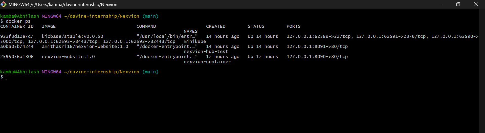

### 2. Kubernetes Pods Running:

This screenshot shows the Kubernetes application Pods and their readiness status.

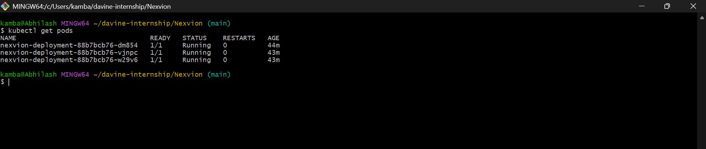

### 3. Kubernetes Service:

This screenshot shows the Kubernetes Service configured to expose the Nexvion application through a NodePort.

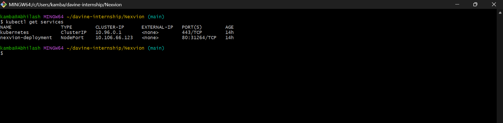

### 4. GitHub Actions CI Workflow

This screenshot shows a successful GitHub Actions workflow run for the Nexvion DevOps project. The workflow was triggered by a push to the `main` branch, and the build job completed successfully.

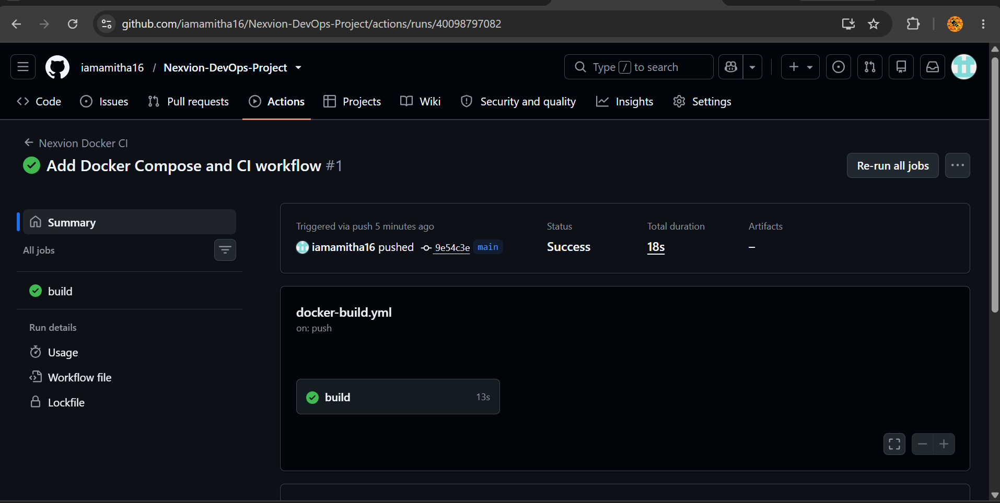

### 5. Docker Images and Version Tags:

This screenshot shows the Nexvion Docker images available locally in Docker Desktop, including version tags 1.0 and 1.1. The two version tags were used to demonstrate Kubernetes rolling update and rollback operations.

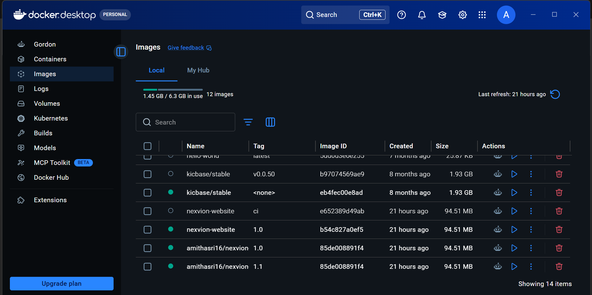

### 6. Docker Desktop Containers:

This screenshot shows Docker Desktop with the Nexvion test container running and the Minikube container active. The Nexvion container maps host port 8091 to container port 80.

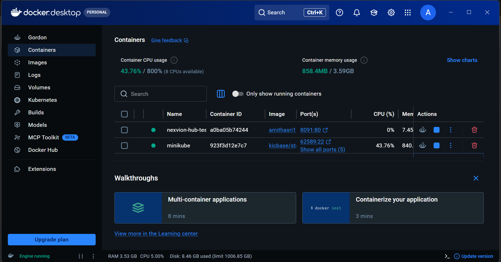

### 7. Trivy Docker Image Vulnerability Scan:

This screenshot shows the Trivy vulnerability scanning step running as part of the GitHub Actions CI workflow. The scan step completed successfully as part of the overall build job.

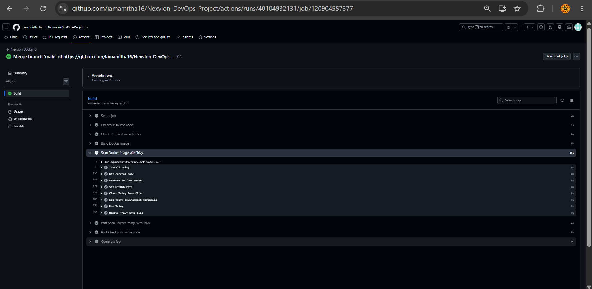

### 8. Kubernetes Deployment and Rollout History:

This screenshot shows the Nexvion Kubernetes Deployment with three replicas ready and the rollout revision history. The current application image is `amithasri16/nexvion-website:1.0` following the rollback test.

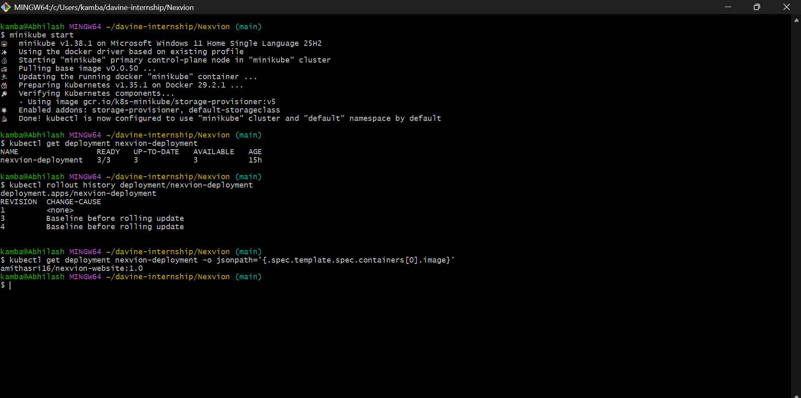

### 9. Kubernetes Rollback:

A Kubernetes rollback was performed to revert the Nexvion Deployment to its previous revision. The rollout status and replica readiness were checked after the operation.

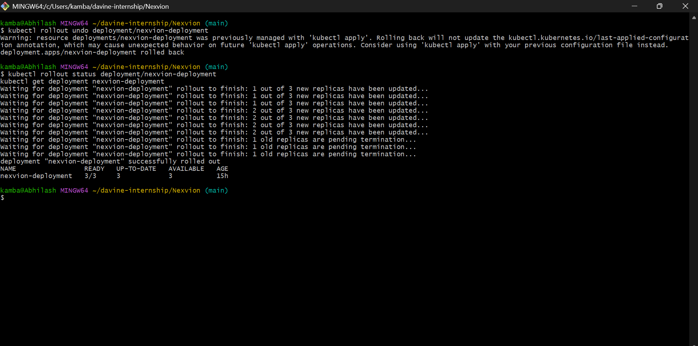

### 10. Kubernetes Self-Healing:

Kubernetes self-healing was tested by deleting one application Pod. The Deployment controller automatically created a replacement Pod to maintain the desired replica count of three.

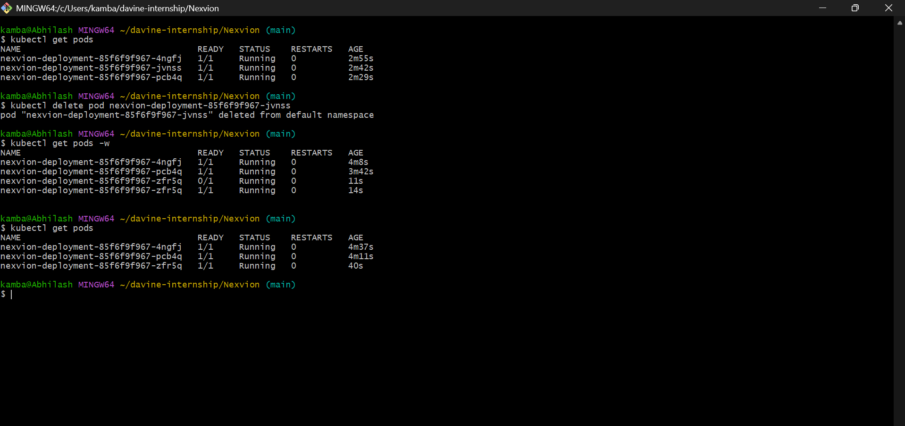

### 11. Nexvion Website Running:

The Nexvion e-commerce demo website is served using Nginx inside a Docker container. The screenshot shows the website successfully displayed in a browser at `http://localhost:8090`.

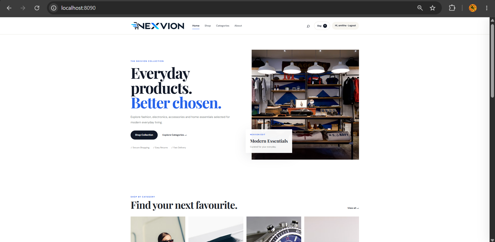


## 16. Project Limitations:

Nexvion is a frontend e-commerce demonstration website.

Login, registration, shopping cart, and checkout functionality are implemented on the client side. The project does not include a production authentication backend, database-backed order processing, or a real payment gateway.

Do not use this demo to collect real passwords or payment details.

The current Trivy workflow reports vulnerability findings but does not fail solely because vulnerabilities are detected.

The Kubernetes deployment runs locally on Minikube and is not a production cloud deployment.

## 17. Future Enhancements:

- Add automated application tests to the CI pipeline.
- Configure the pipeline to fail when selected critical vulnerabilities are found.
- Automate Docker image publishing through GitHub Actions.
- Add monitoring, logging, and application metrics.c
- Deploy the application to a managed Kubernetes service.
- Introduce a backend and database for a production-style application.
- Improve security practices and image maintenance.


## Key Learnings

Through this project, I gained practical experience in:

- Using Git and GitHub to manage project source code.
- Writing a Dockerfile and building container images.
- Running applications with Docker and Docker Compose.
- Automating build and validation steps using GitHub Actions.
- Integrating Trivy for container image vulnerability scanning.
- Publishing and retrieving container images from Docker Hub.
- Creating Kubernetes Deployments and Services using YAML manifests.
- Managing replicas, readiness probes, liveness probes, and resource limits.
- Understanding Kubernetes self-healing through Pod replacement.
- Performing rolling updates and rollback operations.
- Troubleshooting container and Kubernetes deployment issues.


## 18. Conclusion:

This project demonstrates a DevOps workflow for the Nexvion e-commerce demo website using Git, GitHub, Docker, Nginx, Docker Compose, GitHub Actions, Trivy, Docker Hub, Kubernetes, and Minikube.

The project covers containerization, automated image building, security scanning, image publishing, Kubernetes deployment, Service exposure, replica scaling, health checks, self-healing, rolling updates, and rollback.

It provides practical experience with important DevOps tools and workflows, including container management, CI automation, image security scanning, and Kubernetes application lifecycle management.
